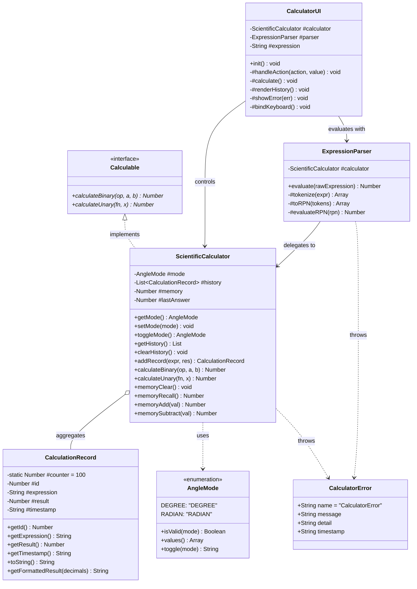

# 🔬 Object-Oriented Scientific Calculator

[](https://pages.github.com/)
[](https://developer.mozilla.org/en-US/docs/Web/JavaScript)
[-orange)](#)
[](LICENSE)

A modern, responsive, high-precision Scientific Calculator web application built with clean, modular HTML5, CSS3, and ES6+ JavaScript classes. Engineered directly from foundational Object-Oriented Programming (OOP) specifications, enforcing strict mathematical domain integrity via custom checked exceptions and persistent in-memory session audit logging.

Ready to deploy immediately onto **GitHub Pages** as a pure static frontend with zero bundler or backend requirements.

---

## 📌 Table of Contents
1. [Aim & Abstract](#-aim--abstract)
2. [OOP Architecture & Class Design](#-oop-architecture--class-design)
3. [System Architecture Diagram](#-system-architecture-diagram)
4. [Mathematical Domain Integrity & Exception Handling](#-mathematical-domain-integrity--exception-handling)
5. [Java Paper vs. ES6+ Web Implementation Mapping](#-java-paper-vs-es6-web-implementation-mapping)
6. [Key Features](#-key-features)
7. [Keyboard Shortcuts Reference](#-keyboard-shortcuts-reference)
8. [Deployment to GitHub Pages](#-deployment-to-github-pages)
9. [Local Development & Verification](#-local-development--verification)

---

## 🎯 Aim & Abstract

### Aim
To design, architect, and implement a comprehensive Scientific Calculator application utilizing Object-Oriented Programming (OOP) principles, supporting basic arithmetic, trigonometric functions, logarithms, powers, square roots, and integer factorials, with dynamic angle mode switching (`DEGREE` / `RADIAN`), calculation history tracking, and robust custom exception handling.

### Abstract
Mathematical and scientific evaluation software must enforce strict domain integrity while maintaining an extensible, decoupled, and user-friendly architecture. Standard calculation utilities often suffer from tightly coupled procedural designs and unhandled edge cases such as division by zero, non-positive logarithmic arguments, and negative square roots.

This project delivers an enterprise-grade web application translating academic OOP specifications into modular ES6+ JavaScript. The computational core cleanly abstracts calculation logic from user interaction, enforces mathematical domain constraints through a custom `CalculatorError` hierarchy, and maintains a chronological session audit log via auto-incremented `CalculationRecord` models.

---

## 🏛️ OOP Architecture & Class Design

The application is structured into modular ES6 modules inside `/js/`:

```
oop-scientific-calculator/
├── index.html                  # Semantic HTML5 presentation shell
├── css/
│   └── styles.css              # Glassmorphic Dark/Light responsive styles
├── js/
│   ├── app.js                  # Application bootstrap & entry point
│   ├── enums/
│   │   └── AngleMode.js        # Frozen enum-like object (DEGREE, RADIAN)
│   ├── errors/
│   │   └── CalculatorError.js  # Custom Error subclass for domain violations
│   ├── models/
│   │   └── CalculationRecord.js# Session audit record with auto-increment ID (#101+)
│   ├── engine/
│   │   ├── Calculable.js       # Abstract contract interface
│   │   ├── ScientificCalculator.js # Core computational engine
│   │   └── ExpressionParser.js # Shunting-Yard RPN mathematical parser
│   └── ui/
│       └── CalculatorUI.js     # Presentation & DOM controller
├── tests/
│   └── calculator.test.js      # Automated unit test suite (46 tests)
└── README.md                   # Complete architectural documentation
```

### 1. `AngleMode` (Enumeration)
- **Path:** `js/enums/AngleMode.js`
- **Concept:** Implemented as a frozen value object (`Object.freeze`) providing compile-time type safety and semantic modeling for angular units (`DEGREE`, `RADIAN`).
- **Methods:** `isValid(mode)`, `values()`, and `toggle(currentMode)`.

### 2. `CalculatorError` (Custom Exception Handling)
- **Path:** `js/errors/CalculatorError.js`
- **Concept:** Subclasses JavaScript's native `Error` class to create a domain-specific exception type.
- **Behavior:** Prepends `"Math Error: "` prefix matching the project specifications and preserves full stack traces.
- **Triggers:** Division by zero, modulo by zero, negative square roots, undefined logarithms ($x \le 0$), tangent asymptotic points (e.g. $90^\circ, 270^\circ$), and non-integer/negative factorials.

### 3. `CalculationRecord` (Model & Session Tracking)
- **Path:** `js/models/CalculationRecord.js`
- **Concept:** Encapsulates the evaluation metadata of a single computation.
- **Encapsulated Fields:**
  - `private static #counter = 100`: Global sequence generator (records start with ID #101).
  - `private #id`: Unique auto-incremented integer ID.
  - `private #expression`: The mathematical formula evaluated.
  - `private #result`: The evaluated numeric answer.
  - `private #timestamp`: Formatted date-time (`yyyy-MM-dd HH:mm:ss`).
- **Methods:** `getId()`, `getExpression()`, `getResult()`, `getTimestamp()`, `getFormattedResult()`, and `toString()`.

### 4. `Calculable` (Abstraction / Interface Contract)
- **Path:** `js/engine/Calculable.js`
- **Concept:** Defines the abstract computational contract establishing polymorphic expectations.
- **Contract Methods:**
  - `calculateBinary(op, a, b)`
  - `calculateUnary(fn, x)`

### 5. `ScientificCalculator` (Core Computational Engine)
- **Path:** `js/engine/ScientificCalculator.js`
- **Concept:** Implements `Calculable`. Owns the internal calculation state, angular mode configuration, memory registers (`MC`, `MR`, `M+`, `M-`), answer register (`ANS`), and session history collection.
- **Encapsulation:** Internal state is held in private fields (`#mode`, `#history`, `#memory`, `#lastAnswer`) accessible only via validated getters and setters.
- **Defensive Copying:** `getHistory()` returns a shallow copy of the record collection to prevent external mutation.

### 6. `ExpressionParser` (Grammar & Tokenizer)
- **Path:** `js/engine/ExpressionParser.js`
- **Concept:** Tokenizes and evaluates complex algebraic expressions using Dijkstra's Shunting-Yard algorithm and Reverse Polish Notation (RPN).
- **Architecture Integrity:** The parser does **not** perform calculations itself; it strictly tokenizes operands and delegates every binary and unary computation to the `ScientificCalculator` engine, ensuring error trapping rules remain unified.

### 7. `CalculatorUI` (Presentation Controller)
- **Path:** `js/ui/CalculatorUI.js`
- **Concept:** Decoupled presentation layer managing DOM events, display formatting, keyboard bindings, theme toggling (`data-theme="dark|light"`), and history sidebar rendering.

---

## 📊 System Architecture Diagram



---

## 🛡️ Mathematical Domain Integrity & Exception Handling

The calculation engine strictly validates inputs against mathematical domain limits and throws `CalculatorError` instances:

| Operation | Domain Rule | Exception Message |
| :--- | :--- | :--- |
| **Division (`/`)** | Divisor $b \ne 0$ ($|b| < 10^{-12}$) | `Math Error: Division by zero is undefined.` |
| **Modulo (`%`)** | Divisor $b \ne 0$ ($|b| < 10^{-12}$) | `Math Error: Modulo by zero is undefined.` |
| **Square Root (`√`)** | Radicand $x \ge 0$ | `Math Error: Cannot calculate square root of negative number.` |
| **Common Log (`log10`)** | Argument $x > 0$ | `Math Error: log10 is undefined for values <= 0.` |
| **Natural Log (`ln`)** | Argument $x > 0$ | `Math Error: Natural log ln is undefined for values <= 0.` |
| **Tangent (`tan`)** | $x \ne 90^\circ + k \cdot 180^\circ$ (DEG mode) | `Math Error: tan is undefined at <x> degrees.` |
| **Tangent (`tan`)** | $\cos(x) \ne 0$ (RAD mode) | `Math Error: tan is undefined at <x> radians.` |
| **Factorial (`n!`)** | $x \ge 0$ and $x \in \mathbb{Z}$ | `Math Error: Factorial is only defined for non-negative integers.` |
| **Factorial (`n!`)** | $x \le 170$ (IEEE-754 overflow) | `Math Error: Factorial overflow for n > 170.` |
| **Exponent (`x^y`)** | $a < 0$ and $b \notin \mathbb{Z}$ | `Math Error: Negative base with non-integer exponent yields a complex number.` |

When an error is thrown, the UI activates a glassmorphic red error alert banner, shakes smoothly for feedback, and preserves the user's input buffer for correction.

---

## 🔄 Java Paper vs. ES6+ Web Implementation Mapping

This web application maintains a 1-to-1 fidelity with the reference Java console application:

| Java Specification | ES6+ Web Implementation | Architectural Role |
| :--- | :--- | :--- |
| `enum AngleMode { DEGREE, RADIAN }` | `AngleMode` in `js/enums/AngleMode.js` | Angular enumeration & value object |
| `class CalculatorException extends Exception` | `class CalculatorError extends Error` | Custom checked exception hierarchy |
| `interface Calculable` | `class Calculable` with abstract contracts | Behavioral interface abstraction |
| `class CalculationRecord` | `class CalculationRecord` with `#` private fields | Immutable audit model & auto-ID `#101+` |
| `class ScientificCalculator implements Calculable` | `class ScientificCalculator extends Calculable` | Core engine, state encapsulation |
| `List<CalculationRecord> history` | `#history = []` with defensive cloning | In-memory session audit collection |
| `class Main` (CLI Menu) | `CalculatorUI` & `ExpressionParser` | Presentation layer & Shunting-Yard evaluator |

---

## ✨ Key Features

1. **Precision Arithmetic & Scientific Operations**:
   - Arithmetic: `+`, `-`, `×`, `÷`, `%`, `±`.
   - Trigonometry: `sin`, `cos`, `tan` with dynamic `DEGREE` / `RADIAN` conversion.
   - Powers & Roots: $x^y$, $x^2$, $x^3$, $\sqrt{x}$, $1/x$, $|x|$.
   - Logarithms & Constants: $\log_{10}$, $\ln$, $\pi \approx 3.14159$, $e \approx 2.71828$.
   - Combinatorics: Factorial ($n!$) with non-negative integer domain checks.
2. **Interactive Angle Mode Switch**:
   - Visual toggle switch and status badge for `DEG` vs `RAD` mode.
3. **Session Audit History Panel**:
   - Collapsible slide-over drawer (mobile) or side-panel (desktop).
   - Records chronological calculations in format: `[yyyy-MM-dd HH:mm:ss] ID: #101 | Expression = Result`.
   - **Click to Reuse**: Tap any past record to instantly insert its result into the current calculation.
   - **Export Log**: Download the complete session audit trail as a formatted `.txt` file.
   - **Clear History**: Safely reset history with a single click.
4. **Memory Registers**:
   - Standard scientific memory registers: `MC` (Clear), `MR` (Recall), `M+` (Add), `M-` (Subtract), and `ANS` (Previous Answer).
   - Visual `M` indicator lights up when memory contains a stored value.
5. **Modern Glassmorphism UI**:
   - Dark Slate / Navy glassmorphic aesthetic matching professional laboratory instrumentation.
   - High-contrast Light Mode with persistent `localStorage` theme preference.
   - Smooth button press ripple and scaling animations.
   - Synthesized button click audio feedback (Web Audio API, no external audio files).
6. **Full Keyboard Support**:
   - Complete physical keyboard navigation for rapid computational workflows.

---

## ⌨️ Keyboard Shortcuts Reference

| Key(s) | Action / Function |
| :--- | :--- |
| `0` - `9` | Input Digits |
| `.` | Decimal Point |
| `+`, `-`, `*`, `/` | Basic Binary Operators (`+`, `−`, `×`, `÷`) |
| `%` | Modulo Operator |
| `^` | Power Function ($x^y$) |
| `(` and `)` | Parentheses grouping |
| `Enter` or `=` | Evaluate Expression |
| `Backspace` | Backspace / Delete Last Token (DEL) |
| `Escape` | All Clear (AC) |
| `!` | Factorial ($n!$) |
| `s` | Sine function (`sin(`) |
| `c` | Cosine function (`cos(`) |
| `t` | Tangent function (`tan(`) |
| `l` | Logarithm base-10 (`log(`) |
| `n` | Natural Logarithm (`ln(`) |
| `p` | Constant Pi ($\pi$) |
| `e` | Euler's Number ($e$) |

---

## 🚀 Deployment to GitHub Pages

This repository is designed specifically as a static frontend with **no build steps, bundlers, or backend dependencies**.

### Step-by-Step Deployment Instructions:

1. **Initialize Git Repository** (if not already done):
   ```bash
   cd oop-scientific-calculator
   git init
   git add .
   git commit -m "feat: initial release of Object-Oriented Scientific Calculator"
   ```

2. **Push to GitHub**:
   ```bash
   git branch -M main
   git remote add origin https://github.com/<your-username>/<your-repo-name>.git
   git push -u origin main
   ```

3. **Enable GitHub Pages**:
   - Go to your repository on GitHub.
   - Click on **Settings** > **Pages** (in the left sidebar).
   - Under **Build and deployment** > **Branch**:
     - Select branch: `main`
     - Select folder: `/ (root)`
     - Click **Save**.

4. **Access Your Live Site**:
   - Within 1–2 minutes, GitHub will deploy your application to:
     ```
     https://<your-username>.github.io/<your-repo-name>/
     ```

---

## 🧪 Local Development & Verification

Because native ES6 modules are used (`<script type="module">`), modern browsers require pages to be served over HTTP/HTTPS rather than the `file://` protocol.

### Option 1: Using Python (Built-in)
```bash
# Python 3
python3 -m http.server 8000
```
Open [http://localhost:8000](http://localhost:8000) in your web browser.

### Option 2: Using Node.js `npx serve`
```bash
npx serve .
```

### Option 3: VS Code Live Server
Right-click `index.html` and select **"Open with Live Server"**.

### Running the Automated Test Suite:
Run the comprehensive test suite directly with Node.js:
```bash
node tests/calculator.test.js
```
The test suite validates:
- `AngleMode` enumeration & state transitions
- `CalculationRecord` auto-incrementing IDs (starting at #101) and formatting
- Binary operations (`+`, `-`, `*`, `/`, `%`, `^`)
- Unary functions (`sin`, `cos`, `tan`, `sqrt`, `log`, `ln`, `fact`)
- All mathematical domain exception triggers matching Java specifications
- ExpressionParser algebraic precedence, parentheses, and implicit multiplication

---

## 📄 License
This project is open-source under the [MIT License](LICENSE).
